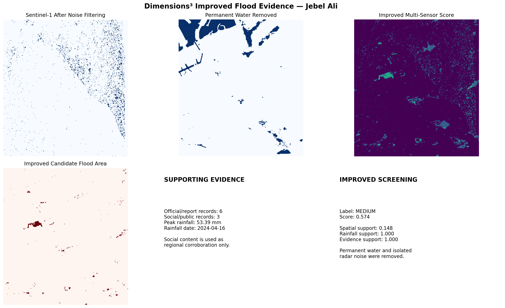

# Dimensions³ — Jebel Ali Flood Evidence PoC

**Team:** Dimensions³ · **Theme:** Climate and Disaster · **Country:** United Arab Emirates

Dimensions³ combines satellite imagery, rainfall, and event reports to screen for possible flood-related surface changes around Jebel Ali, Dubai, during April 2024.

## 1. Business Use Case

Municipalities, emergency teams, and infrastructure planners need to know where to prioritize inspections after extreme rainfall. They currently have to examine satellite imagery, weather information, and incident reports separately.

This proof of concept brings those sources together in one evidence dashboard. It is intended to help users decide **where further investigation is warranted**.

## 2. Problem

Flash floods can develop rapidly in arid regions. Earth Observation data can show surface changes across a large area, including places without ground sensors, but different satellite products are difficult to compare and interpret together.

The challenge is to turn those observations into a clear screening result while showing the evidence and its limitations.

## 3. Data Used

| Source | Product and provider | Dates | Use | Access and attribution |
| --- | --- | --- | --- | --- |
| Sentinel-1 | SAR Level-1 GRD, Copernicus | 12 and 24 April 2024 | VV/VH radar change | Free and open Copernicus Sentinel data; acknowledge Copernicus |
| Sentinel-2 | MSI Level-2A surface reflectance, accessed through Microsoft Planetary Computer | 12 and 22 April 2024; tile `40RBN` | Optical water-change index | Copernicus Sentinel data terms; acknowledge Copernicus |
| Landsat 9 | Collection 2 Level-2 surface reflectance, USGS; accessed through Microsoft Planetary Computer | 3 and 19 April 2024 | Independent optical comparison | USGS Landsat data are public domain; cite USGS |
| Weather | NASA POWER daily point data | 1–30 April 2024; approximately 24.98°N, 55.05°E | Rainfall timing and context | Public NASA POWER data; cite NASA POWER |
| Reports | Public government, scientific, and news references recorded in the notebook | April 2024 | Regional event context | Follow each original source's terms |
| Public content | Links recorded in the notebook | April 2024 | Regional corroboration only | Original creators retain rights; media are not redistributed here |

**Study area:** bounding box `[55.00, 24.90, 55.10, 25.00]`, in `[west, south, east, north]` order.

**Hyperspectral imagery:** planned for future work; it is **not used** in this PoC.

## 4. Technical Approach

1. Search for the selected before-and-after scenes.
2. Inspect Sentinel-2 and Landsat optical imagery.
3. Calculate the Modified Normalized Difference Water Index:

   `MNDWI = (Green − SWIR) / (Green + SWIR)`

4. Compare before-and-after Sentinel-1 VV and VH measurements.
5. Screen out some pre-existing water and apply a light noise filter.
6. Combine candidate-change masks with rainfall and event references.
7. Export figures and JSON summaries for the Dimensions³ website.

The notebook uses thresholds and manually chosen weights to produce a **heuristic screening score**. The score is not a trained model's accuracy or a calibrated probability of flooding.

**Important technical limitation:** the current notebook resizes image masks by array dimensions. This does not establish that pixels from different sensors represent the same ground locations. Its apparent multi-sensor pixel overlap must therefore be treated as an exploratory visualization, not validated geographic agreement.

## 5. Installation

The analysis was developed in Google Colab. The repository includes pinned dependencies in `requirements.txt`.

To obtain the files locally:

```bash
git clone https://github.com/vfatimaalkaabi/dimensions3-flood-poc.git
cd dimensions3-flood-poc
python -m venv .venv
source .venv/bin/activate
pip install -r requirements.txt
```

On Windows, activate the environment with `.venv\Scripts\activate` instead.

The notebook also contains a Colab `!pip install` command. This works in a notebook environment; the exported `.py` file is not a standalone Python application.

## 6. How to Run

Open `Dimensions3_FinalCode.ipynb` in Google Colab and run the cells in order.

The notebook retrieves Sentinel-2, Landsat 9, and weather data through public services. Its Sentinel-1 step expects **two locally supplied ZIP products** named `2024-04-12_before.zip` and `2024-04-24_after.zip` in `/content/`. These ZIP products are **not included in this repository**. The notebook also writes to `/content/dimensions3_project/`.

Consequently, **the current notebook cannot yet reproduce the headline result from a repository clone alone**. The Sentinel-1 input products or a fully documented download script, relative paths, and a fresh-runtime test are still needed before this repository meets the competition's reproducibility requirement.

External catalogues may impose rate limits or change availability. Running the full notebook requires downloading satellite data and may take substantially longer than a small local example.

## 7. Example Input and Output

The current inputs are described in Section 3. A small committed sample input, or a script that retrieves the exact Sentinel-1 products, is still required for a self-contained reviewer run.

Example figures are committed in [`results/`](results/). The main output is:



The notebook also produces before-and-after imagery, a rainfall chart, evidence tables, and JSON summaries under `/content/dimensions3_project/` when run in Colab.

## 8. Results and Limitations

The exploratory run produced:

| Measure | Result |
| --- | ---: |
| Screening label | MEDIUM |
| Heuristic score | 0.574 |
| Candidate pixels reported as a percentage of the analysis grid | 0.74% |
| Peak daily NASA POWER precipitation for the selected point | 53.39 mm on 16 April 2024 |
| Recorded supporting references | 9 |

The **0.74% is not a verified flooded-area estimate**. The method has not been validated against a georeferenced flood map or local field observations. Precision, recall, F1-score, and intersection-over-union are therefore unknown.

Additional limitations include uncalibrated Sentinel-1 measurements, differing observation dates and spatial resolutions, imperfect masking of permanent water, possible radar speckle and optical false positives, and approximate rather than geographic alignment of the sensor masks. News and public content support the occurrence of the regional event; they do not verify individual Jebel Ali pixels. The NASA POWER point value is a gridded estimate, not a local rain-gauge reading.

This PoC is **not suitable for operational alerts or emergency decisions** without further processing and validation.

## 9. Future Work

- Supply a small, openly shareable sample or an exact, automated Sentinel-1 download procedure.
- Replace Colab-specific absolute paths with repository-relative paths and verify a fresh-kernel run.
- Calibrate and terrain-correct Sentinel-1 data.
- Align all satellite layers using their coordinate reference systems and pixel transforms.
- Validate against independently mapped flood extents or geotagged incident records.
- Add road and infrastructure exposure analysis.
- Explore hyperspectral imagery where event-date coverage is available.
- Consider machine learning only after assembling trustworthy labeled examples.
- Serve the validated results through the Dimensions³ website.

## 10. Team, Licence, and Attribution

**Team members and roles**

- **Alia Alblooshi — Website and integration:** Developed the platform interface and connected analysis outputs to the website.
- **Fatima Alkaabi — Data pipeline and analysis:** Collected and processed the satellite, rainfall, and supporting evidence; developed the notebook and multi-source screening.
- **Wadha Alkaabi — Satellite imagery:** Supported Sentinel-1, Sentinel-2, and Landsat data preparation and interpretation.
- **Fatima Alnuaimi — Evidence and validation:** Reviewed weather data, event references, results, and limitations.
- **Mariam Alneyadi — Reproducibility and presentation:** Prepared repository documentation, tested the reviewer workflow, and developed the submission slides.
**Code licence:** Add a `LICENSE` file and state the team's chosen licence here before submission. The third-party data and media retain their own terms.

Data-provider references:

- [Copernicus Data Space terms](https://dataspace.copernicus.eu/terms-and-conditions)
- [USGS Landsat Collection 2 Level-2](https://www.usgs.gov/landsat-missions/landsat-collection-2-level-2-science-products)
- [NASA POWER referencing guide](https://power.larc.nasa.gov/docs/referencing/)

Credit for the original satellite and weather data belongs to their respective providers. Public media links in the notebook do not grant permission to redistribute the underlying photos or videos.
