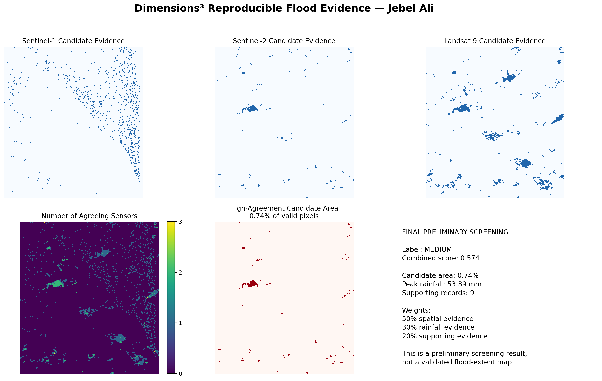

# Dimensions³ — Jebel Ali Flood Evidence PoC

**Team:** Dimensions³  
**Country:** United Arab Emirates  
**Theme:** Climate-induced Disasters

Dimensions³ is a multi-source Earth Observation proof of concept that combines satellite imagery, rainfall data, official reports, and public evidence to screen for possible flood-related surface changes around Jebel Ali, Dubai.

## 1. Business Use Case

Dimensions³ is designed for:

- Municipalities and local government authorities
- Emergency-management and civil-defense teams
- Infrastructure and port operators
- Environmental and climate-risk authorities
- Insurance and risk-assessment organizations
- Urban planners and researchers

These users need to identify locations that may have experienced flood-related surface changes, understand the evidence supporting the result, and prioritize inspections or emergency response.

Current Earth Observation, weather, and event-report data are distributed across different platforms and can be difficult for non-specialists to interpret quickly. Dimensions³ converts these sources into understandable maps, evidence summaries, and a transparent preliminary confidence level.

## 2. Problem

Arid regions such as the United Arab Emirates can experience sudden intense rainfall and flash flooding. Flood impacts may develop quickly across roads, industrial zones, ports, and urban infrastructure.

Satellite imagery can provide broad and repeated observations, but individual sensors have limitations:

- Optical imagery can be affected by clouds and shadows.
- Radar imagery can contain speckle, coastline effects, and changes unrelated to flooding.
- Permanent water may be incorrectly classified as new floodwater.
- News and public reports confirm an event but do not provide precise flood boundaries.

The challenge is to combine these different forms of evidence into a transparent and reproducible preliminary screening result.

## 3. Data Used

### Sentinel-1

- Product: Sentinel-1 Interferometric Wide Swath GRD
- Provider: Copernicus Data Space Ecosystem
- Instrument: C-band Synthetic Aperture Radar
- Polarizations: VV and VH
- Before date: 12 April 2024
- After date: 24 April 2024
- Processing level: Level-1 GRD
- Licence: Copernicus Sentinel Data Terms and Conditions

### Sentinel-2

- Product: Sentinel-2 MSI Level-2A
- Access provider: Microsoft Planetary Computer
- Instrument: MultiSpectral Instrument
- Tile: 40RBN
- Before date: 12 April 2024
- After date: 22 April 2024
- Processing level: Level-2A surface reflectance
- Licence: Copernicus Sentinel Data Terms and Conditions

### Landsat 9

- Product: Landsat Collection 2 Level-2
- Provider: United States Geological Survey
- Before scene: `LC09_L2SP_160043_20240403_02_T1`
- After scene: `LC09_L2SP_160043_20240419_02_T1`
- Before date: 3 April 2024
- After date: 19 April 2024
- Processing level: Collection 2 Level-2 surface reflectance
- Licence: USGS Landsat data are available without restriction and are considered public-domain data

### Weather data

- Product: NASA POWER daily meteorological data
- Provider: NASA Prediction of Worldwide Energy Resources
- Period: April 2024
- Variables: precipitation, temperature, and wind speed
- Approximate location: 24.98°N, 55.05°E
- Licence and attribution: NASA POWER data policy and documentation

### Supporting evidence

The project also uses official reports, news coverage, and publicly accessible event videos as regional corroborating evidence.

Public reports and social-media content are referenced using their original URLs. They are not treated as pixel-level ground truth and are not redistributed as project-owned material.

### Hyperspectral data

Hyperspectral imagery is not used in the current proof of concept. It is proposed as future work for improved surface-material, moisture, and water-quality analysis where appropriate data are available.

## 4. Technical Approach

The workflow follows these steps:

1. Define the Jebel Ali area of interest.
2. Search for before-and-after Sentinel-2 and Landsat scenes.
3. Load Sentinel-1 VV and VH measurement data.
4. Compare Sentinel-1 radar backscatter before and after the event.
5. Calculate water-related optical indices from Sentinel-2 and Landsat.
6. Generate candidate water-change masks for each sensor.
7. Reduce isolated radar noise.
8. Remove permanent-water and coastline effects where possible.
9. Transform the processed masks to a common analysis grid.
10. Identify pixels supported by at least two satellite sources.
11. Add rainfall, official-report, and public-evidence support.
12. Calculate a transparent preliminary evidence score.
13. Save maps, figures, tables, and JSON summaries.

The main optical water-related index is the Modified Normalized Difference Water Index:

```text
MNDWI = (Green - SWIR) / (Green + SWIR)
```

The reproducible evidence score uses the following transparent weighting:

```text
Combined score =
    50% spatial evidence
  + 30% rainfall evidence
  + 20% supporting-report evidence
```

This combined score is a heuristic evidence score. It is not a formal machine-learning accuracy measurement.

## 5. Installation

The lightweight reproducible notebook requires Python 3.11.

```bash
git clone https://github.com/vfatimaalkaabi/dimensions3-flood-poc.git
cd dimensions3-flood-poc

python -m venv .venv
source .venv/bin/activate

pip install -r requirements.txt
```

For Windows:

```bash
.venv\Scripts\activate
pip install -r requirements.txt
```

## 6. How to Run

### Reviewer-friendly reproducible notebook

Run:

```bash
jupyter lab notebooks/02_main_analysis.ipynb
```

Open the notebook and select **Run All**.

The notebook:

- Locates the committed sample input
- Loads the three processed satellite evidence masks
- Recalculates multi-sensor agreement
- Recalculates the combined evidence score
- Produces the final example figure
- Writes a machine-readable JSON summary

Expected runtime is less than two minutes on a standard laptop. No GPU is required.

The notebook can also be opened directly in Google Colab:

[Open the reproducible notebook in Google Colab](https://colab.research.google.com/github/vfatimaalkaabi/dimensions3-flood-poc/blob/main/notebooks/02_main_analysis.ipynb)

### Complete research workflow

The full data-collection and processing workflow is available in:

[`Dimensions3_FinalCode.ipynb`](Dimensions3_FinalCode.ipynb)

The complete workflow uses the original satellite products and may require additional download time, memory, and temporary Colab storage.

## 7. Example Input and Output

### Example input

The small processed sample is committed at:

[`data/sample_input/dimensions3_sample_input.npz`](data/sample_input/dimensions3_sample_input.npz)

It contains:

- Processed Sentinel-1 candidate mask
- Processed Sentinel-2 candidate mask
- Processed Landsat 9 candidate mask
- Valid-land analysis mask
- Peak-rainfall value
- Official-report count
- Public-evidence count
- Study-area and event metadata

The sample excludes full satellite scenes so that the repository remains small and reproducible.

### Example output

The reproducible result is available at:

- [`results/reproducible_flood_evidence_result.png`](results/reproducible_flood_evidence_result.png)
- [`results/reproducible_flood_evidence_summary.json`](results/reproducible_flood_evidence_summary.json)



Additional outputs are available in the [`results/`](results/) folder.

## 8. Results

The reproducible demonstration produces:

- Sentinel-1 candidate-water evidence: approximately 2.7%
- Sentinel-2 candidate-water evidence: approximately 0.85%
- Landsat 9 candidate-water evidence: approximately 4.05%
- High-agreement candidate pixels: 873
- Valid analysis pixels: 118,327
- High-agreement candidate area: 0.74%
- Peak rainfall: 53.39 mm
- Official reports: 6
- Public supporting-evidence records: 3
- Total supporting records: 9
- Combined evidence score: 0.574
- Preliminary screening label: **MEDIUM**

The result indicates that multiple sources provide preliminary support for flood-related surface change around the study area. Locations highlighted by the output should be treated as candidates for further inspection rather than confirmed flooded pixels.

## 9. Validation, Limitations, and Future Work

### Validation

The proof of concept validates reproducibility by committing a small sample that reproduces the same headline result as the complete workflow.

The score is based on agreement between satellite evidence, rainfall, and event reports. It has not been validated against an independent georeferenced flood-extent map.

### Limitations

- The combined score is heuristic and is not a formal accuracy percentage.
- No independent ground-truth flood map was available for precision, recall, F1, or Intersection-over-Union evaluation.
- The masks are processed onto a common array grid, but full geographic co-registration requires further validation.
- Sentinel-1 radar changes may result from roughness, moisture, construction, geometry, or registration effects.
- Optical imagery may be affected by clouds, shadows, and acquisition-date differences.
- Permanent water and coastline effects may create false positives.
- Social-media content provides regional corroboration only.
- The current proof of concept studies one event and one area.

### Future work

- Use radiometrically calibrated and terrain-corrected Sentinel-1 RTC data.
- Perform precise geographic co-registration across all satellite sources.
- Validate predictions using field observations or independent flood maps.
- Calculate precision, recall, F1 score, and Intersection over Union.
- Add local rain-gauge, radar-rainfall, and official NCM data.
- Use longer satellite time series instead of only two dates.
- Add digital elevation, slope, drainage, soil, and land-cover data.
- Train a CNN or segmentation model using labelled flood examples.
- Add uncertainty calibration and explainable-AI outputs.
- Explore hyperspectral imagery for moisture and surface-material analysis.
- Add near-real-time processing and automated event alerts.
- Integrate the analysis outputs into the Dimensions³ website.
- Support downloadable maps, evidence packets, and inspection reports.
- Extend the platform to wildfire, earthquake-impact, and other climate-risk applications.

## 10. Team, Licence, and Attribution

### Team members and roles

- **Alia Alblooshi — Website and integration:** Developed the platform interface and connected analysis outputs to the website.
- **Fatima Alkaabi — Data pipeline and analysis:** Collected and processed the satellite, rainfall, and supporting evidence; developed the notebook and multi-source screening.
- **Wadha Alkaabi — Satellite imagery:** Supported Sentinel-1, Sentinel-2, and Landsat data preparation and interpretation.
- **Fatima Alnuaimi — Evidence and validation:** Reviewed weather data, event references, results, and limitations.
- **Mariam Alneyadi — Reproducibility and presentation:** Prepared repository documentation, tested the reviewer workflow, and developed the submission slides.

### Project licence

The project code is released under the MIT License. Third-party datasets, reports, images, and services remain subject to their respective provider terms and licences.

### Attribution

This project uses or references data and services from:

- [Copernicus Data Space Ecosystem](https://dataspace.copernicus.eu/)
- [Microsoft Planetary Computer](https://planetarycomputer.microsoft.com/)
- [USGS Landsat Missions](https://www.usgs.gov/landsat-missions)
- [NASA POWER](https://power.larc.nasa.gov/)
- [OpenStreetMap](https://www.openstreetmap.org/), where applicable
- Original publishers of the referenced official reports, news articles, and public event videos

Dimensions³ does not claim ownership of third-party satellite data, reports, news material, or public videos.
